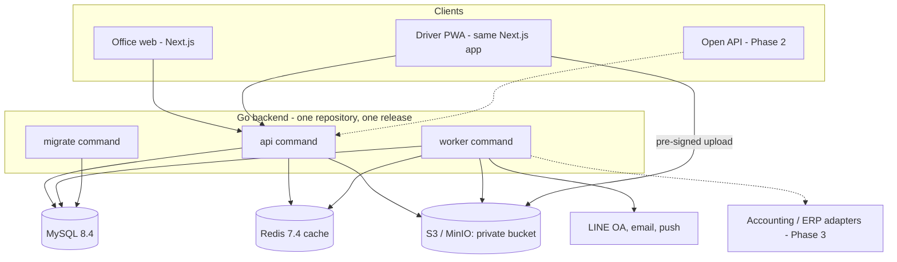

# Nova Logistics Architecture

**Baseline: 28 October 2026.** Stack confirmed by the owner (D-09): Go modular monolith, Next.js web, MySQL 8.4, Redis cache, S3 object storage. Details marked *proposed* follow the ADRs' status. Nothing here is built yet.

## Recommended shape



- **api** serves the OpenAPI 3.1 contract to the web app and the PWA; it never runs long work.
- **worker** runs jobs from the MySQL queue: imports, exports, ZIP build and unpack, expiry scans, notifications, retention deletes, outbox delivery.
- **migrate** applies versioned migrations with the migrator identity, then exits.
- Web and PWA are one Next.js app (`apps/web`) using generated types from `contracts/openapi/nova-logistics-api.json`.

## Repository layout (proposed)

```
backend/
  cmd/api  cmd/worker  cmd/migrate  cmd/operator
  internal/platform/   config, db, cache, objectstore, jobs, outbox, audit, httpx, i18n, crypto
  internal/modules/<module>/  domain, application, adapters, transport
  internal/archtest/   import-rule tests
  migrations/          NNNNNN_<name>.up.sql / .down.sql
apps/web/              Next.js (office + driver PWA)
contracts/openapi/     nova-logistics-api.json
platform/              compose.yaml (MinIO, Redis), later k8s or cloud manifests
scripts/               verify-backend, verify-web, local helpers
docs/
```

## Module ownership

| Module | Owns | Phase |
| --- | --- | --- |
| access | Tenants, users, memberships, roles, branch scope, sessions, OTP, LINE identities, API credentials (Phase 2) | 1 |
| settings | Tunable figures with inheritance site → customer → branch → company → default | 1 |
| customization | UDA definitions and field settings for standard fields | 1 |
| crm | Customers (hirers) and customer sites | 1 |
| workforce | Drivers, contacts, addresses, bank accounts, lifecycle, blacklist | 1 |
| documents | Document types, documents, versions, review, expiry state, compliance | 1 |
| fleet | Vehicles, ownership, insurance policies, tax, assignments, odometer, service reminders, maintenance log | 1 |
| equipment | Equipment catalogue, issue and return | 1 |
| inspections | Checklist templates, inspections, photos, defects | 1 |
| files | Object metadata, upload grants, virtual folders, ZIP jobs | 1 |
| bulkdata | Import/export jobs, mappings, templates, batch undo | 1 |
| notifications | Inbox, email, LINE OA, push; delivery log | 1 |
| reports | Dashboards and report queries (read models) | 1 |
| subscriptions | Plans, usage counts | 1 |
| scheduling, attendance, leave | Shifts, check-in/out, leave (ported from nova-sg-all patterns) | 2 |
| integrations | Public API, webhooks, partner credentials | 2 |
| orders, logistics, fuel, routing | Orders, trips, POD, fuel logs, route suggestions | 3 |

A module owns its tables and is reached through its root-package interface. Cross-module references are IDs without foreign keys across module boundaries. `internal/archtest` enforces the rule.

## Runtime components

| Component | Version | Role | Not used for |
| --- | --- | --- | --- |
| MySQL | 8.4 LTS | Business state, audit, job queue, outbox, idempotency keys, file metadata | — |
| Redis | 7.4 | Cache-aside for settings, UDA definitions, permissions, catalogues, dashboard counts; rate limits; OTP codes; job progress ([ADR-0004](adr/0004-redis-as-cache-only.md)) | Jobs, outbox, records, authority |
| S3-compatible storage | MinIO locally; provider P-02 | Documents, photos, exports, ZIPs ([ADR-0005](adr/0005-s3-object-storage.md)) | Public links |
| Job queue | MySQL table with leases | Urgent lane (notifications, small jobs) and bulk lane (imports, ZIPs, exports, scans); per-tenant concurrency limit | — |

Jobs and outbox rows are written in the same transaction as the business change. The worker claims with a lease, retries with backoff and records the outcome; a crashed worker's lease expires and another reclaims it.

## Tenant and scope isolation

- Shared schema, `tenant_id BINARY(16)` on every tenant-owned row, composite keys `(tenant_id, id)` ([ADR-0003](adr/0003-mysql-84-and-shared-schema-tenancy.md)).
- The request context (tenant, membership, roles, branch scope) is built on the server from the session; a client may select among its own memberships but never names its authority.
- Branch scope filters every list, export, import target and file download for scoped roles.
- Platform team access to a tenant's data needs an explicit, time-limited, audited support grant.
- Tests: wrong tenant, wrong branch, revoked membership, guessed IDs, export, import into another tenant's IDs, file key of another tenant, cache key collision.

## Files, ZIP and the document browser

- Object key `t/{tenant_id}/{module}/{yyyy}/{mm}/{object_id}`; metadata in MySQL (owner record, original name, MIME sniffed from content, size, SHA-256, uploader, capture time, GPS).
- Upload: API checks access and quota → pre-signed PUT (multipart above 16 MB) → client uploads → API confirms size and hash → record linked.
- Download: pre-signed GET ≤ 5 minutes after a fresh access check; every open audited.
- Browser folders are virtual: `Drivers/{code – name}/{document type}`, `Vehicles/{plate}/{type}`, `Company/{type}`, built from metadata, so one file is found by person, vehicle or type.
- ZIP upload (worker): stream-unzip; limits (proposed 2 GB, 5,000 files, 50 MB per file); zip-bomb guard (ratio and total size); MIME sniffing; malware scan (P-19); match by file name `{citizen_id|driver_code|plate}_{doc_type_code}[_{expiry yyyymmdd}].ext` or folder path; unmatched files to a review tray; optional metadata sheet in the archive.
- ZIP download (worker): built into a temporary object, link valid 24 hours, audited.
- Images re-encoded without EXIF; capture time and GPS kept as fields.

## Import/export engine

See [ADR-0007](adr/0007-spreadsheet-grade-bulk-data.md). Upload → sheet and header detection → mapping (saved per tenant, Thai aliases from TTP's import) → dry run with row errors → commit job → result file. Upsert on natural keys; batch ID on every row for undo. Export any grid view, including UDA columns, as xlsx or csv; tenant-defined export templates replace customer-specific code.

## Caching rules

Cache-aside with tenant-prefixed keys and a version in the key; TTL ≤ 10 minutes for definitions and ≤ 60 seconds for counts; write paths bump the version in MySQL and delete the key. Authorization decisions on write paths re-read the authoritative version. The system must pass its tests with Redis empty; one suite runs with Redis stopped.

## Integration boundary

- Every state change writes a domain event to the outbox (`driver.created`, `driver.status_changed`, `document.approved`, `document.expiring`, `document.expired`, `vehicle.assigned`, `inspection.failed`, …).
- Internal API and the future public API (`/integrations/v1`, Phase 2) reuse the same application use cases; the public contract is versioned separately ([08](08-open-api-and-integrations.md)).
- Accounting and ERP are reached by adapters on events (Phase 3). Nova Logistics never keeps a general ledger (D-08).

## Data and policy rules

- Money in minor units with currency; instants in UTC; display in the tenant's timezone (default Asia/Bangkok); BE/CE only at the edges.
- Original observations (odometer, inspection, uploaded file) are never edited; corrections are new records with a reason.
- Settings figures are copied onto records whose meaning they decide (e.g. the alert threshold that fired).
- Protected fields (citizen ID, passport, bank account, criminal record) encrypted at field level with a key from the cloud KMS (local: a development key); a keyed hash supports duplicate checks without decrypting.

## Deployment and recovery (proposed)

Cloud provider and runtime are open (P-02). Whatever is chosen: separate UAT and production databases, buckets and Redis; images built once and promoted; migrations as a one-shot job before rollout; daily database backup with point-in-time recovery; bucket versioning; a restore rehearsal before the pilot; health and smoke checks after each deploy.

## Verification and extraction gates

Before the pilot: tenant isolation suite, worker crash/reclaim, Redis-down suite, import of 10,000 drivers, ZIP of 500 files, restore rehearsal. Extract a module into its own service only for measured independent scale, a separate security boundary or separate team ownership, through a new ADR.
