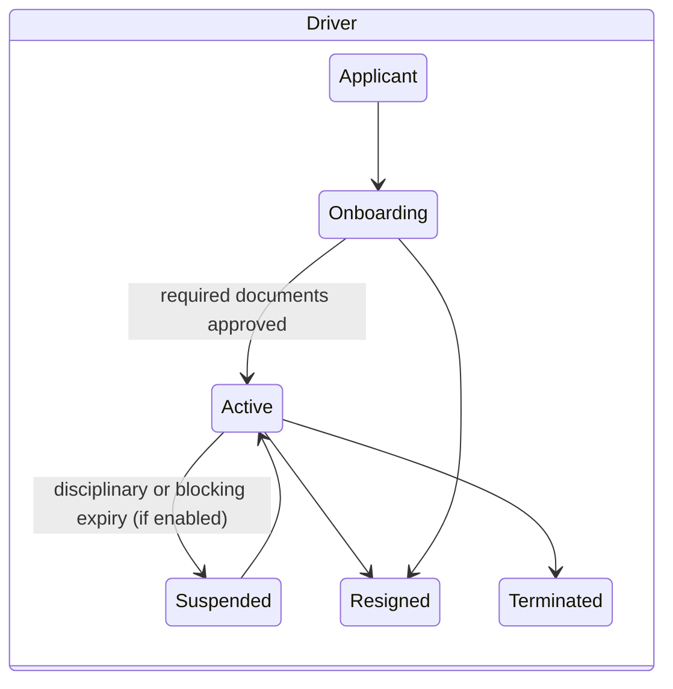
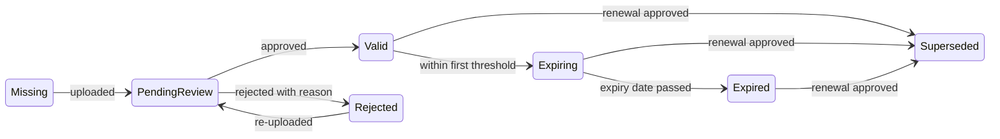
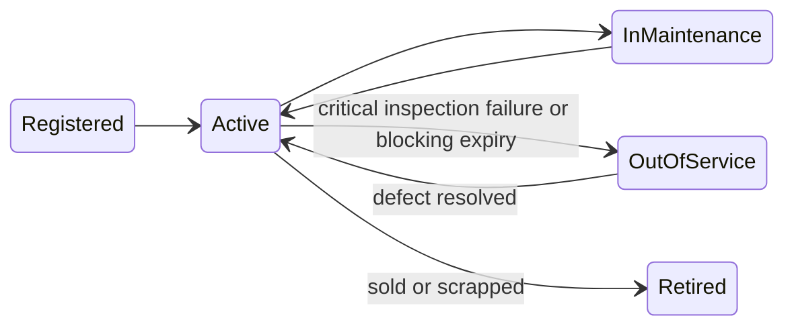

# Data Model (Phase 1)

**Status: proposed, 28 October 2026.** Standard fields cover Thai compliance and what TTP and SWP both track. Everything else is a UDA field in the row's JSON extension ([07](07-tenant-customization-uda.md)). Every tenant-owned table carries `tenant_id` and `(tenant_id, id)` keys, `version`, `created_at/by`, `updated_at/by`, and `custom_values` where UDA applies.

## Entities

| Module | Entity | Purpose | Key standard fields |
| --- | --- | --- | --- |
| access | tenant, branch | Subscribing company and its depots/hubs | name, tax ID, plan, timezone; branch name TH/EN, address, point |
| crm | customer, customer site | Hirers (Big C, ALL Now) and their stores/DCs | name, code; site code, name, address, point, zone |
| workforce | driver | A rider or driver, employee or contractor | see below |
| workforce | driver contact, driver address, driver bank account | 1-to-many children | type, value, primary; address type; bank, account no (encrypted), account name, primary |
| fleet | vehicle | Motorcycle, pickup, van or truck | see below |
| fleet | vehicle assignment | Who drove what, when | vehicle, driver, role (primary, pool, temporary), from, to, start/end odometer |
| fleet | insurance policy | CMI and voluntary cover | kind, class, insurer, policy no, start, end, premium, sum insured, paid by, document link |
| fleet | odometer reading | Append-only meter log | value km, read at, source, photo, recorded by, anomaly flag |
| fleet | service reminder, maintenance record | Light maintenance | rule (km or months), due; date, odometer, vendor, cost, invoice file |
| documents | document type | Tenant catalogue | code, names, subject, has expiry, default validity, required rule, reminder offsets, blocking, review required |
| documents | document, document version | A document and its file versions | subject type and ID, type, number, issue date, expiry date, status, version no, reviewer, reason |
| equipment | equipment item, equipment issue | Catalogue and issue/return checklist | item, serial, holder (driver or vehicle), issued, returned, condition at issue and return (deposits and stock later, D-18) |
| inspections | inspection template, inspection, inspection item result, defect | Checklists and follow-up | template version and items; result, photos, GPS, signature; defect severity, status, owner, due |
| files | file object | Metadata of stored objects | key, original name, MIME, size, SHA-256, uploader, capture time, GPS, retention class |
| customization | custom field definition | UDA schema | see [07](07-tenant-customization-uda.md) |
| bulkdata | import job, export job, import mapping | Bulk operations | file, mapping, counts, row errors, batch ID, undo state |
| platform | audit event, outbox event, job | Change log, integration events, work queue | actor, entity, before/after; type, payload, published; lane, lease, attempts |

## Standard driver fields

| Group | Standard (* required) | Typical UDA |
| --- | --- | --- |
| Identity | code*, title, first and last name TH*, first and last name EN, nickname, citizen ID or passport/work-permit no*, nationality, date of birth, gender, photo | shirt size, blood type |
| Contact | mobile*, email, LINE ID, registered address, current address, emergency contacts | second phone |
| Employment | employment type* (employee, contractor, freelance, agency), status*, status reason, join date, end date and reason, rehire eligible, home branch*, primary customer site, qualified vehicle classes*, source channel, recruiter | referral code, team |
| Finance | bank accounts (tax ID = citizen ID) | PromptPay ID |
| Other | tags, notes | — |

The driver's primary key is a generated ID, never the citizen ID (SWP's design blocks foreign workers and corrections).

## Standard vehicle fields

| Group | Standard (* required) | Typical UDA |
| --- | --- | --- |
| Identity | plate*, plate province*, class* (2W, EV 2W, 3W, 4W pickup, van, 6W, 10W, trailer), body type, brand, model, year (CE stored), colour, VIN/chassis no, engine no, cc or motor kW, fuel/powertrain* | box size, wrap |
| Ownership | ownership* (company-owned, driver-owned, leased/rented, financed or rent-to-own; all supported, D-26), owner name, owner ID (encrypted), lessor or financier, contract end, acquired on | monthly rental |
| Operation | status*, home branch, current odometer (derived), payload kg and volume m³ (4W and up) | fleet card no |

## Default document types

| Code | Document | Subject | Expires | 2W | 4W | Blocking |
| --- | --- | --- | --- | --- | --- | --- |
| `id_card` | ID card | Driver | Yes | Required | Required | Yes |
| `passport` | Passport (foreign worker) | Driver | Yes | Conditional | Conditional | Yes |
| `work_permit` | Work permit | Driver | Yes | Conditional | Conditional | Yes |
| `house_reg` | House registration | Driver | No | Required | Required | No |
| `driving_licence` | Driving licence (class per vehicle class) | Driver | Yes | Required | Required | Yes |
| `cmi` | CMI (พ.ร.บ.) | Vehicle | Yes, 1 year | Required | Required | Yes |
| `voluntary_insurance` | Voluntary insurance | Vehicle | Yes, 1 year | Optional | Required | Per customer |
| `registration_book` | Registration book (เล่มทะเบียน) | Vehicle | No | Required | Required | No |
| `vehicle_tax` | Annual tax (ป้ายภาษี) | Vehicle | Yes, 1 year | Required | Required | Yes |
| `power_of_attorney` | Power of attorney (owner ≠ driver) | Vehicle | Optional | Conditional | Conditional | No |
| `criminal_record` | Criminal record check | Driver | Tenant sets | Required | Required | No |
| `medical_cert` | Medical certificate | Driver | Yes, 1 year | Optional | Required | No |
| `contract` | Employment or service contract | Driver | Per contract | Required | Required | No |
| `bank_book` | Bank book | Driver | No | Required | Required | No |
| `photo` | Photograph | Driver | No | Required | Required | No |
| `training_cert` | Training certificate | Driver | Optional | Optional | Optional | No |

Every row is a seed: a tenant switches off any type it does not use, decides what is required per vehicle class and customer, and adds its own (e.g. a site-access card) (D-17).

## Lifecycles

"Expiring" and "Expired" are computed from the expiry date and the settings in force by the daily scan, and stored with the threshold that fired so alerts are sent once.
